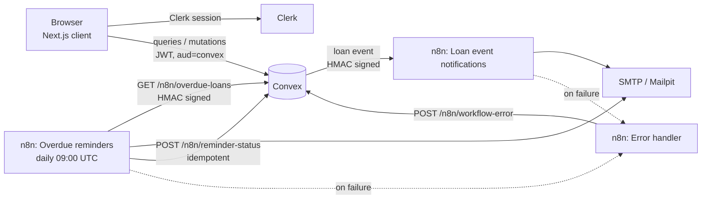

# LendLoop

**Borrow what you need. Lend what you don't.**

A neighborhood tool-lending board. Neighbors list tools, request to borrow them for a date
range, and lenders approve, decline and mark loans returned. n8n sends the notifications and
the daily overdue reminders.

Stack: Next.js 16 (App Router) · Clerk · Convex · n8n 2.45 · TypeScript · Tailwind CSS 4.

- [Run it locally](#run-it-locally)
- [Environment variables](#environment-variables)
- [Architecture](#architecture)
- [Roles and access control](#roles-and-access-control)
- [n8n workflows](#n8n-workflows)
- [Security and data minimization](#security-and-data-minimization)
- [Tests](#tests)
- [What I would change for production](#what-i-would-change-for-production)

---

## Run it locally

You need Node 20+ and Docker.

```bash
npm install

# 1. Convex. Pick "local" when asked, or log in to use a cloud dev deployment.
#    Writes NEXT_PUBLIC_CONVEX_URL and NEXT_PUBLIC_CONVEX_SITE_URL to .env.local.
#    Leave it running.
npx convex dev

# 2. Clerk. Create an application at dashboard.clerk.com (email sign-in is enough) and copy
#    NEXT_PUBLIC_CLERK_PUBLISHABLE_KEY and CLERK_SECRET_KEY into .env.local (see .env.example).
#    Then create the "convex" JWT template. The Clerk CLI reads the secret key from .env.local:
npx clerk api /jwt_templates --file scripts/clerk-jwt-template.json --yes

# 3. Generate the integration secrets and set the Convex environment.
#    Your email becomes the first admin once you sign in with it.
./scripts/setup-local.sh you@example.com

# 4. n8n and Mailpit (a local inbox that catches every email n8n sends).
docker compose up -d

# 5. The app.
npm run dev
```

| URL | What |
| --- | --- |
| http://localhost:3000 | LendLoop |
| http://localhost:5678 | n8n editor (create the local owner account on first visit) |
| http://localhost:8025 | Mailpit inbox: every notification and reminder lands here |

On start-up the n8n container imports the SMTP credential (built from environment variables),
imports the three workflows from `n8n/workflows/` and publishes them. Nothing to click.

**Try the overdue reminder without waiting days.** Sign in once with two accounts, then seed a
loan that ended two days ago and run the workflow:

```bash
npx convex run seed:overdueLoan '{"lenderEmail":"a@example.com","borrowerEmail":"b@example.com"}'
# n8n editor > "LendLoop - Overdue reminders" > Execute workflow, or from the CLI:
docker compose exec -e N8N_RUNNERS_BROKER_PORT=5690 -e N8N_PORT=5691 n8n n8n execute --id=lendloopRemind01
```

Run it twice: the second run sends nothing, because that loan already got a reminder today.
The loan card shows "Overdue reminder sent · just now".

**See a failure handled.** Run `docker compose stop mailpit`, then approve or decline a request.
n8n tries the email three times and fails, the error workflow reports it to Convex, and Convex
keeps retrying the webhook with backoff. Admin > Automation health shows both. Start Mailpit
again and the next retry delivers.

## Environment variables

**`.env.local`** (Next.js, see `.env.example`)

| Name | Purpose |
| --- | --- |
| `NEXT_PUBLIC_CONVEX_URL`, `NEXT_PUBLIC_CONVEX_SITE_URL`, `CONVEX_DEPLOYMENT` | Written by `npx convex dev` |
| `NEXT_PUBLIC_CLERK_PUBLISHABLE_KEY`, `CLERK_SECRET_KEY` | Clerk application keys |
| `NEXT_PUBLIC_CLERK_SIGN_IN_URL`, `NEXT_PUBLIC_CLERK_SIGN_UP_URL` | `/sign-in`, `/sign-up` |

**Convex deployment** (`npx convex env set`, done by `scripts/setup-local.sh`)

| Name | Purpose |
| --- | --- |
| `CLERK_JWT_ISSUER_DOMAIN` | Clerk Frontend API URL. Convex verifies tokens against its JWKS |
| `ADMIN_EMAILS` | Comma-separated. A user becomes admin on first sign-in only if the email is listed **and verified** |
| `CONVEX_TO_N8N_SECRET` | HMAC secret for Convex → n8n webhooks |
| `N8N_TO_CONVEX_SECRET` | HMAC secret for n8n → Convex calls |
| `N8N_LOAN_EVENT_WEBHOOK_URL` | n8n production webhook URL |
| `APP_URL` | Base URL for links in emails |

**`.env.n8n`** (Docker, generated, gitignored): `CONVEX_TO_N8N_SECRET`, `N8N_TO_CONVEX_SECRET`,
`N8N_ENCRYPTION_KEY`, `CONVEX_SITE_URL`. Optional: `SMTP_HOST`, `SMTP_PORT`, `SMTP_USER`,
`SMTP_PASSWORD`, `SMTP_SECURE`, `LENDLOOP_FROM_EMAIL`.

There are two secrets, one per direction, so a leak on one side does not let anyone forge the
other.

## Architecture



```
convex/
  schema.ts            users, tools, loans, notifications (outbox), automationEvents,
                       workflowErrors, auditLog
  lib/auth.ts          getCurrentUser / requireUser / requireAdmin: every check starts here
  lib/hmac.ts          signing and constant-time verification for both directions
  tools.ts, loans.ts   public and authenticated functions, each one checks the caller
  admin.ts             admin-only queries and mutations
  notifications.ts     transactional outbox and webhook delivery with retries
  automation.ts        internal functions behind the n8n HTTP endpoints
  http.ts              /n8n/overdue-loans, /n8n/reminder-status, /n8n/workflow-error
  seed.ts              internal demo helper
src/
  proxy.ts             redirects signed-out visitors away from /app (convenience only)
  app/page.tsx         public page
  app/app/*            Browse, My listings, My requests, Incoming requests, Admin
n8n/
  workflows/*.json     the three exported workflows
  init.sh              container start-up: import credential and workflows, publish
```

**Why an outbox.** A loan change and its notification row are written in one Convex mutation,
and delivery is scheduled from that same transaction. If the mutation fails, no webhook goes
out. If it commits, delivery is always attempted, then retried after 30 s, 2 min, 10 min and
30 min. After five attempts the row is marked `failed` and shows on the loan and in the admin
view.

**Why the app pages render on the client.** Every signed-in view is a live Convex subscription,
so loan status and automation activity update without a refresh. The pages themselves are
static shells.

**Dates** are calendar dates (`YYYY-MM-DD`) in UTC, on the server and in the UI.

## Roles and access control

Two roles, stored in the Convex `users` table. The client never sends a role, and no public
mutation can change one. Admins come from `ADMIN_EMAILS` (verified email only), or from an
internal function that only the CLI can run:

```bash
npx convex run users:setRole '{"email":"someone@example.com","role":"admin"}'
```

Every Convex function checks the caller. The UI hides what you cannot do, but it is not the
boundary: `src/proxy.ts` only redirects signed-out visitors.

| Action | user | admin |
| --- | --- | --- |
| See available tools (name and category) | yes, signed out too | yes |
| Browse all tools with status | yes | yes |
| List a tool | yes | yes |
| Edit a listing | own only | own only |
| Delete a listing | own only | **any** (audited) |
| Request to borrow | not own tools | not own tools |
| Approve / decline / mark returned | requests on own tools | requests on own tools |
| Cancel a request | own pending requests | own pending requests |
| View all loans, automation health | no | yes |
| Mark a lender as Trusted Lender | no | yes (audited) |

A loan the caller is not part of reads as "not found", not "forbidden", so ids cannot be
probed. Approval re-checks for overlapping bookings inside the mutation. Convex mutations are
serializable, so two approvals for the same dates cannot both win. Approving one request
declines the pending requests that overlap it, and those borrowers are notified.

## n8n workflows

All three live in `n8n/workflows/` and are imported on container start.

**LendLoop - Loan event notifications** (Webhook)
`Webhook → Verify signature → valid? → Already processed? → Compose message → Send email → Remember event → 200`

- Verifies `HMAC-SHA256(secret, "${timestamp}.${rawBody}")` with a constant-time compare and a
  5-minute timestamp window. An invalid request gets `401` and nothing else runs.
- Passes on only the fields the email needs.
- Deduplicates on `eventId` (the outbox row id). If Convex retries because a response was lost
  after the email went out, the event is acknowledged without a second email. The id is
  recorded only after a successful send, so a failed send can still be retried.
- `Send email` tries three times. If it still fails, the webhook answers `500`, Convex retries
  later, and the error workflow reports the failure.

**LendLoop - Overdue reminders** (Schedule, daily 09:00 UTC, plus a manual trigger)
`Schedule → Sign request → GET /n8n/overdue-loans → one item per loan → Send reminder → Mark sent | Mark failed → Sign write-back → POST /n8n/reminder-status`

- Convex returns overdue loans minus the ones that already got a successful reminder today.
- A failed email does not stop the batch. It takes the error branch, is written back as
  `failed`, and is offered again on the next run.
- Write-backs are keyed `overdue-reminder:{loanId}:{date}`. Retries and reruns update the same
  row (`failed` can become `sent`, never the reverse), so a duplicate record cannot appear.

**LendLoop - Error handler** (Error Trigger)
The error workflow of the other two. It logs the failure and posts a signed report to
`/n8n/workflow-error`, which is idempotent on the n8n execution id. A failed run therefore shows
in three places: the n8n executions list, the n8n logs, and Admin > Automation health in the app.

## Security and data minimization

- **Authorization lives in Convex.** One helper module, called at the top of every function.
  Roles come from our database, not from token claims or the client.
- **Little data in the token.** The Clerk `convex` JWT template carries only `aud`, `email`,
  `email_verified` and `given_name`, and lives 60 seconds.
- **Public page.** The query returns `{ name, category }` and nothing else: no ids, owner or
  description. The projection happens on the server, not in the UI.
- **Webhook payloads.** Recipient email and first name, the other party's first name, tool
  name, dates and status. No notes, no other user's email, no internal user ids. The borrower's
  note to the lender stays in Convex.
- **Signed in both directions.** Each direction has its own secret. Inbound signatures also
  cover the method and path, so a signature for one endpoint cannot be replayed against
  another. With no secret configured, every request is rejected (`503`), never accepted.
- **Secrets.** Generated by the setup script, never printed, stored in `.env.n8n` and the Convex
  environment. Workflows reference them as `$env.*`. The SMTP credential is built from
  environment variables at start-up. CI fails if a literal secret appears in a workflow file.
- **Input validation.** Enums for category and condition, length caps on text, real calendar
  dates, no start date in the past, at most 30 days per loan and 180 days ahead, at most 10
  open requests per borrower.
- **Audit log.** Admin removal of someone else's listing and Trusted Lender changes are
  recorded with the actor.
- **Soft delete.** Removing a listing keeps its loan history, and a tool that is still out on
  loan can still be returned.

## Tests

```bash
npm test          # Convex functions, with convex-test
npm run check     # typecheck + lint + tests
```

19 tests cover role bootstrapping (an unverified allowlisted email stays a user),
unauthenticated writes, admin-only functions, ownership on edit and delete, admin removal with
audit, the public projection, lender-only approve, decline and return, request validation and
double booking, overlap auto-decline, inbound signature checks (missing, forged, stale, wrong
route, no secret configured), idempotent write-backs and reruns, outbound signing and payload
fields, and webhook retries ending in success or failure.

## What I would change for production

- **Hosting.** A Convex production deployment, a Clerk production instance, and n8n behind
  HTTPS with `N8N_SECURE_COOKIE` on and the editor not reachable from the internet.
- **n8n secrets.** `N8N_BLOCK_ENV_ACCESS_IN_NODE=false` lets anyone with editor access read the
  HMAC secrets. I would restrict editor access, use n8n external secrets (Vault, AWS Secrets
  Manager), and run the task runners in external mode.
- **Dedup store.** The `eventId` set lives in n8n workflow static data, which is fine for one
  instance. With queue mode or several workers I would move it to Redis or Postgres with a
  unique key.
- **Real email.** Replace Mailpit with a transactional provider through the same SMTP
  credential, with SPF, DKIM and DMARC. Add notification preferences and unsubscribe.
- **Scale.** Availability is computed on read. With many tools I would store the current loan on
  the tool, paginate the browse and admin lists, and add search.
- **Abuse.** Per-user rate limits on requests and listings (the Convex rate limiter component),
  and a way to report a listing.
- **Alerting.** Alert on failed notifications and workflow errors, which are already in Convex,
  instead of relying on someone opening the admin page.
- **Time zones.** Store a time zone per user and send reminders at a local hour.
- **Key rotation.** Accept two secrets on each side during a rotation window.
